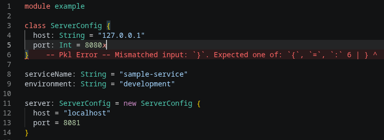
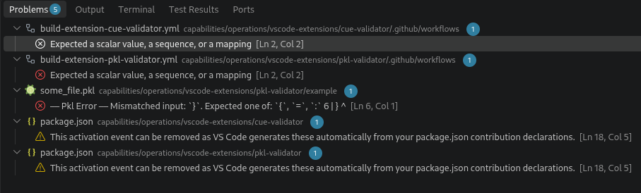

# PKL Validator

Catch configuration mistakes before they reach production.

A VS Code extension. Search for "pkl-validator".

pkl-validator helps you validate the currently open .pkl files against the nearest local `.pkl` schema in your workspace. It gives you instant feedback while you edit, so schema drift, missing fields, and invalid values are caught early instead of during deployment.

A minimal VS Code extension that runs the local `pkl` CLI against open PKL files and reports errors in the Problems panel.

## Features

- Validates `.pkl` files on save and as you edit
- Runs `pkl eval <file>`
- Maps PKL diagnostics into VS Code diagnostics

## Screenshots

## Usage

1. Install the extension in VS Code.
2. Ensure the `pkl` binary is available on your PATH.
3. Open a `.pkl` file and edit it.

If the `pkl` CLI is not on your PATH, set the `PKL_BIN` environment variable to the full binary path.

## Important runtime requirement

A `pkl` binary must be available on your PATH. If not, install `pkl` using `homebrew` (Mac) or `apt` (Debian), etc.

## Recommended

Install Error Lens (usernamehw.errorlens) for enhanced error highlighting

## Feature requests

If you encounter an issue or want to see a feature, simply open an issue here on github. We'd love to hear from you.
